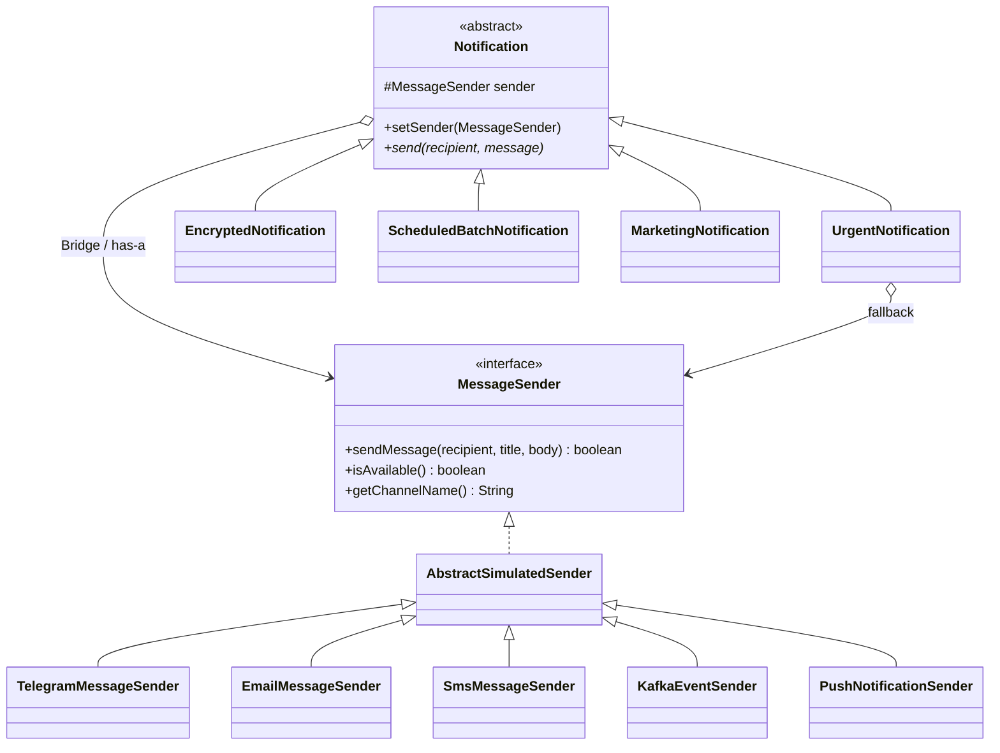

# Assignment 3 — Multi-Channel Notification Gateway

**Course:** Software Design Patterns · **Pattern:** Bridge · **Language:** Java 17+  
**Submission:** GitHub repository + README/UML via Moodle · **Assessment:** Individual defense

## Project purpose

This project simulates message delivery via **Telegram, Email, SMS, Kafka, and Push**, without real external APIs. Four notification types (Urgent, Encrypted, ScheduledBatch, Marketing) remain independent of the channel. The `Notification` abstraction delegates delivery to the `MessageSender` interface — **the Bridge**.

## Run

Open this folder as a **Maven project** in IntelliJ IDEA with JDK 17+.

```bash
mvn clean test
mvn compile
java -cp target/classes kz.aitu.notification.Main
```

If Maven is not installed, you can run `Main.java` directly from IntelliJ after importing the project. `pom.xml` configures JUnit 5 and Java 17.

## Required demo scenarios

1. UrgentNotification + Telegram
2. EncryptedNotification + Email (Base64, educational encoding)
3. ScheduledBatchNotification + SMS (prints Total / Successful / Failed)
4. Runtime switching using **the same** UrgentNotification object: Telegram → Email
5. Telegram unavailable → SMS fallback
6. MarketingNotification + PushNotificationSender

The demo additionally sends a Kafka event. All senders are simulations; no internet or credentials are needed.

## UML class diagram

See [`docs/UML.puml`](docs/UML.puml) — a PlantUML class diagram. It explicitly shows the Abstraction, Refined Abstractions, Implementor, Concrete Implementors, and Bridge relationship. A renderable Mermaid overview:



## README: six mandatory questions

**1. What are the two independent dimensions?**  
(a) *Notification type*: Urgent, Encrypted, ScheduledBatch, Marketing; (b) *Delivery implementation*: Telegram, Email, SMS, Kafka, Push.

**2. Where exactly is the Bridge?**  
The `protected MessageSender sender` field in abstract `Notification`, together with its constructor, `setSender()` and calls to `sender.sendMessage()`. This is composition: the abstraction **has a** delivery implementor.

**3. Why is inheritance problematic here?**  
Without a Bridge, every type/channel combination needs a specialized class (N × M), such as `UrgentTelegramNotification` and `EncryptedEmailNotification`. New channels or types multiply the number of classes and duplicate behavior.

**4. What happens when a new provider is added?**  
Implement `MessageSender` (or extend `AbstractSimulatedSender`) as `PushNotificationSender`, then pass it to any existing `Notification`. Existing notification classes are unchanged.

**5. What happens when a new Notification type is added?**  
Create a new subclass of `Notification`, as with `MarketingNotification`. Every existing `MessageSender` can be reused without modification.

**6. Why is this Bridge rather than Adapter?**  
Bridge intentionally separates two independently variable hierarchies from the start. Adapter instead makes an existing incompatible interface work with a client by translating one interface to another.

## Responsibilities and decisions

- `MessageSender`: interface defining `sendMessage`, `isAvailable`, `getChannelName`.
- `AbstractSimulatedSender`: testing/demo helper with controllable availability and last successful message (not required by Bridge).
- `TelegramMessageSender`: prints a formatted `*title*` message.
- `EmailMessageSender`: prints subject and signature.
- `SmsMessageSender`: **rejects** (does not truncate) bodies above **160 Java characters**; in this project, the body alone is counted, not the title.
- `KafkaEventSender`: prints an event publication simulation.
- `PushNotificationSender`: prints a device-oriented push simulation.
- `UrgentNotification`: prepends `[URGENT]`, uses `isAvailable()`, retries with a configurable `MessageSender` fallback if primary is unavailable or fails.
- `EncryptedNotification`: uses Base64. **Base64 is encoding, not real encryption**; it meets the assignment's explicitly permitted simple transformation.
- `ScheduledBatchNotification`: stores recipient list via `setRecipients()` / `addRecipient()`; loops over configured recipients, counts outcomes and prints a summary. Its inherited `send(recipient, message)` signature uses the configured list rather than the single `recipient` argument. Scheduling here is a **simulation**; no real timer/job queue is specified by the task.
- `MarketingNotification`: prepends `[PROMO]` and an opt-out note; this formatting is an implementation choice since the assignment does not prescribe marketing content.

## JUnit 5 unit tests

`src/test/java/kz/aitu/notification/NotificationGatewayTest.java` has **16 tests** covering delivery, unavailable senders, fallback, length boundaries, Base64, batch success/failure and reset, runtime switching, Push, Marketing, Kafka, and failure when both senders are down.

## Individual defense: quick modifications

- **Add WhatsApp:** create `WhatsAppMessageSender extends AbstractSimulatedSender`, implement `getChannelName()` + `sendMessage()`; use `new UrgentNotification(new WhatsAppMessageSender())`.
- **SMS 160 → 120:** change `SmsMessageSender.MAX_LENGTH`, update tests and rerun.
- **Add SilentNotification:** subclass `Notification`, implement `send()` with desired behavior; sender classes stay unchanged.
- **Make Email unavailable:** `email.setAvailable(false);` and set fallback on `UrgentNotification` or switch via `setSender()`.
- **Add another fallback:** extend `UrgentNotification` to take a list of `MessageSender` fallback implementations and loop over the interface.
- **Switch at runtime:** `notification.setSender(new EmailMessageSender());`.

## Source structure

```text
src/main/java/kz/aitu/notification/
  MessageSender.java, AbstractSimulatedSender.java
  TelegramMessageSender.java, EmailMessageSender.java, SmsMessageSender.java
  KafkaEventSender.java, PushNotificationSender.java
  Notification.java, UrgentNotification.java, EncryptedNotification.java
  ScheduledBatchNotification.java, MarketingNotification.java, Main.java
src/test/java/kz/aitu/notification/NotificationGatewayTest.java
docs/UML.puml
pom.xml
README.md
```
